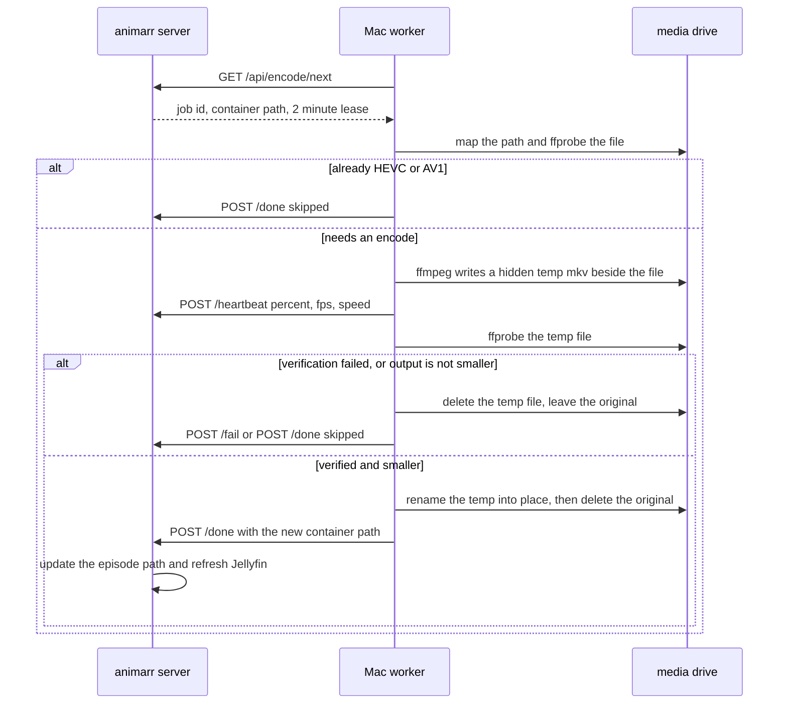

# Encode worker

animarr can re-encode imported episodes to H.265. The container only keeps the queue. The encode runs in a second copy of the same `animarr` binary on the Mac, because that is where `hevc_videotoolbox` is fast.

The container image's ffmpeg has no VideoToolbox. A software encode inside Docker would sit on the CPU for a long time and still would not use the Mac media engine. The worker therefore runs natively, on the host that has the drive and the hardware encoder.

Encoding is off until you turn on `ENCODE_ENABLED`. Quality, encoder, and thread count are flags on the worker. They are not settings on the server.

## What talks to what



A heartbeat extends the lease and stores progress for the Encode page. The page polls that every 3 seconds. It does not read the ffmpeg log itself.

## Prerequisites

On the Mac:

```bash
brew install ffmpeg
ffmpeg -encoders | grep videotoolbox
```

`hevc_videotoolbox` must appear in that list. `libx265` is the software fallback if you pass `--encoder libx265`. The worker checks that the chosen encoder is listed before it claims a job, and it exits if `ffmpeg` or `ffprobe` is not on `PATH`.

The media drive has to be mounted at the host side of `--path-map` before the worker starts. The container path and the Mac path are the same file.

## Build and install

From this repo, on the Mac:

```bash
go build -o animarr ./cmd/animarr
mkdir -p "$HOME/bin"
mv animarr "$HOME/bin/animarr"
```

`$HOME/bin` is a good place for a user launchd agent. `/usr/local/bin/animarr` works too if you want it on the default `PATH`. The server container builds its own copy from the Dockerfile. You do not need the Mac binary inside the container, and you do not need ffmpeg in the image.

`go` 1.23 or newer matches `go.mod`.

## Turn the queue on

In the UI, open Settings → Encode and set Encode to `true`. Save. The same switch is `ENCODE_ENABLED`. It defaults to false. A saved value overrides the environment, which overrides `encodeEnabled` in `CONFIG_FILE`.

While it is off:

- imports are not queued
- `GET /api/encode/next` returns 204, so a running worker claims nothing
- Enqueue library and `animarr encode-enqueue` refuse

Imports still finish first. The encode row is written after the file is in the library and after the Jellyfin refresh. A failure to queue is logged and does not fail the import.

## How the Mac reaches the server

animarr uses `network_mode: container:vpn`. Docker ignores a `ports:` key on that service, so this repo's compose file does not publish 8990. Do not add one.

The homelab vpn compose (`vpn/docker-compose.yml`) already publishes the process on loopback and aliases the name Caddy uses:

- `127.0.0.1:8990:8990` on the vpn service
- `animarr` on the vpn service's `homelab_proxy` network

Use this as `--server`:

```text
http://127.0.0.1:8990
```

That is the recommended URL. The UI has no login, and neither does the encode API (`/api/encode/next`, heartbeat, done, fail, release). Binding it to loopback keeps those routes on the Mac.

The other option is Caddy. The proxy config sends `animarr.$BASE_DOMAIN` to `animarr:8990`. On this homelab that host is `https://animarr.home.mizustack.com`. It is how a browser on another machine reaches the UI. The worker on this Mac does not need it, and using it would send the unauthenticated encode API through the proxy. Prefer `http://127.0.0.1:8990`.

Recreating the vpn container drops the network namespace animarr shares. Recreate the animarr stack afterwards, or the loopback port will not reach the process.

## Path map

The server stores container paths such as `/data/media/anime/...`. The worker maps that prefix onto the mounted drive:

```bash
animarr encode-worker \
  --server http://127.0.0.1:8990 \
  --path-map '/data/media/anime=/Volumes/Seagate 4TB/Videos/sonarr/data/media/anime'
```

The space in `Seagate 4TB` must be quoted in the shell. The split is the first `=`. A path that is not under the container prefix is rejected, including a `..` segment that would leave the prefix.

The reverse map is how a finished `.mkv` is written back into `episodes.file_path`.

## Flags

| Flag | Default | Meaning |
| --- | --- | --- |
| `--server` | `http://127.0.0.1:8990` | Base URL of animarr |
| `--path-map` | required | `container=host` prefix. The host side is one argument, so quote it in a shell when it contains spaces |
| `--ffmpeg` | `ffmpeg` | Encoder binary |
| `--ffprobe` | `ffprobe` | Probe binary |
| `--encoder` | `hevc_videotoolbox` | `hevc_videotoolbox` or `libx265` |
| `--quality` | `0` | `0` selects the encoder default below. VideoToolbox `-q:v` is 1–100, higher is better, default 65. libx265 CRF is 0–51, lower is better, default 22 |
| `--threads` | `0` | libx265 only. `0` leaves the encoder's own pool. A positive value sets `-x265-params pools=N`. VideoToolbox ignores it |
| `--once` | off | Claim one job, then exit |
| `--dry-run` | off | Claim, probe, and log. Do not encode, and do not mark anything skipped or failed. Release the claims on the way out |

`--dry-run --once` probes one job. `--dry-run` without `--once` walks the pending queue, holds each lease with a heartbeat, then releases them all. Holding is required: releasing immediately would make the next claim return the same lowest id.

With no `--once` and no `--dry-run`, the worker loops. An empty queue sleeps 15 seconds. One job is encoded at a time.

## Quality and size

VideoToolbox quality 65 (`-q:v 65`) is the default hardware setting. A 1080p H.264 episode is often around half the size. It depends on the source. libx265 CRF 22 is the software default. It is usually smaller than VideoToolbox at 65, and it is much slower.

The worker will not replace the original when the new file is the same size or larger. That job is `skipped`, the temp file is deleted, and the episode path does not change. Treat "about half" as a typical result, not a guarantee.

10-bit sources stay 10-bit. The worker reads `bits_per_raw_sample` or a 10/12 pixel format from ffprobe. For a 10-bit source it adds `-profile:v main10` and `-pix_fmt p010le` (VideoToolbox) or `-pix_fmt yuv420p10le` (libx265). An 8-bit source is not promoted to 10-bit.

Every encode also sets:

- `-map 0` and `-c copy`, then `-c:v` for the video stream, so audio, subtitles, attachments, and chapters are copied
- `-map_metadata 0`
- `-tag:v hvc1`
- the output is Matroska (`.mkv`), written to a hidden temp name beside the source: `.<filename>.animarr-encode.mkv`

HEVC and AV1 files are not encoded again. The worker probes them and reports `skipped`. The server does not probe. Enqueue will queue any downloaded file, and the worker decides.

## First run

1. Mount the drive. Confirm a library file is visible under `/Volumes/Seagate 4TB/Videos/sonarr/data/media/anime`.
2. Turn on Encode in Settings.
3. Queue the files that are already imported. On the Encode page, use **Enqueue library**. Or, with the vpn container already running:

   ```bash
   docker compose run --rm --no-deps animarr encode-enqueue
   ```

   That prints how many rows were newly queued. Rows that are already `done`, `skipped`, `pending`, or `running` for the same path are left alone. A `failed` row, or a row whose path changed, goes back to `pending`.

4. Dry-run one job, then the queue:

   ```bash
   "$HOME/bin/animarr" encode-worker \
     --server http://127.0.0.1:8990 \
     --path-map '/data/media/anime=/Volumes/Seagate 4TB/Videos/sonarr/data/media/anime' \
     --dry-run --once

   "$HOME/bin/animarr" encode-worker \
     --server http://127.0.0.1:8990 \
     --path-map '/data/media/anime=/Volumes/Seagate 4TB/Videos/sonarr/data/media/anime' \
     --dry-run
   ```

   The log line is `encode dry-run` with `action=encode` or `action=skip`. Nothing is written to the drive.

5. Encode one file:

   ```bash
   "$HOME/bin/animarr" encode-worker \
     --server http://127.0.0.1:8990 \
     --path-map '/data/media/anime=/Volumes/Seagate 4TB/Videos/sonarr/data/media/anime' \
     --once
   ```

6. Leave it running with the launchd agent below.

Each finished encode logs one `encode job` line: encoder, wall-clock `elapsed`, ffmpeg speed such as `2.3x`, `src` and `dst` byte sizes, and `saved` percent. While a job is running, progress is logged about every 15 seconds (`percent`, `fps`, `speed`). The Encode page shows the same running sample as `42% · 80 fps · 2.3x`, from the heartbeat. Speed comes from ffmpeg `-progress` (`speed=2.30x`). Percent is `out_time` divided by the source duration.

A successful replace updates the episode path to the container path of the `.mkv` and asks Jellyfin to rescan. A skipped job does not change the path and does not refresh Jellyfin. If Jellyfin has no URL or API key, the refresh does nothing.

The sibling `.nfo` is named from the file stem (`Demo - S01E01.nfo`), not from the video extension. Changing `.mp4` to `.mkv` leaves that `.nfo` where it is.

## launchd

Save this as `~/Library/LaunchAgents/com.tejesh.animarr.encode.plist`. In the plist the path map is one argument, so the space is not shell-quoted. `Nice` 10 and `ProcessType` `Background` keep it off the interactive priority.

```xml
<?xml version="1.0" encoding="UTF-8"?>
<!DOCTYPE plist PUBLIC "-//Apple//DTD PLIST 1.0//EN" "http://www.apple.com/DTDs/PropertyList-1.0.dtd">
<plist version="1.0">
<dict>
  <key>Label</key>
  <string>com.tejesh.animarr.encode</string>
  <key>ProgramArguments</key>
  <array>
    <string>/Users/tejesh/bin/animarr</string>
    <string>encode-worker</string>
    <string>--server</string>
    <string>http://127.0.0.1:8990</string>
    <string>--path-map</string>
    <string>/data/media/anime=/Volumes/Seagate 4TB/Videos/sonarr/data/media/anime</string>
    <string>--encoder</string>
    <string>hevc_videotoolbox</string>
  </array>
  <key>RunAtLoad</key>
  <true/>
  <key>KeepAlive</key>
  <true/>
  <key>ProcessType</key>
  <string>Background</string>
  <key>Nice</key>
  <integer>10</integer>
  <key>StandardOutPath</key>
  <string>/Users/tejesh/Library/Logs/animarr-encode.log</string>
  <key>StandardErrorPath</key>
  <string>/Users/tejesh/Library/Logs/animarr-encode.err</string>
</dict>
</plist>
```

Load, stop, and inspect:

```bash
launchctl bootstrap gui/$UID ~/Library/LaunchAgents/com.tejesh.animarr.encode.plist
launchctl print gui/$UID/com.tejesh.animarr.encode
launchctl bootout gui/$UID/com.tejesh.animarr.encode
```

Logs:

```bash
tail -f ~/Library/Logs/animarr-encode.log ~/Library/Logs/animarr-encode.err
```

`KeepAlive` starts it again after it exits. `bootout` is how you stop it. SIGINT or SIGTERM during an encode deletes the temp file and returns that job to `pending`.

## Monitoring CPU and GPU usage

VideoToolbox does the work in the media engine. CPU use stays low. libx265 encodes on the CPU and will fill the cores.

Watch it while a job is running:

- Activity Monitor → Window → CPU History, and Window → GPU History. VideoToolbox shows up as media-engine work, with little CPU. libx265 fills the CPU history.
- `top -o cpu` in a terminal. Sort stays on CPU. A VideoToolbox encode should not pin every core. A libx265 encode will.
- `sudo powermetrics --samplers cpu_power,gpu_power -i 2000` prints CPU and GPU power every two seconds. VideoToolbox raises the GPU/media sampler more than the CPU one. libx265 does the opposite.
- Optional: `brew install asitop`, then run `asitop`. It is a compact Apple-silicon view of the same counters. The worker does not require it.

To keep a software encode from taking the machine:

- The launchd plist above already sets `Nice` 10 and `ProcessType` `Background`.
- `taskpolicy -b -p PID` puts a running process in the background band. Replace `PID` with the worker's process id from `launchctl print` or `pgrep animarr`.
- `--threads 4` (or another small count) limits libx265 via `-x265-params pools=N`. It does nothing for `hevc_videotoolbox`.

## Troubleshooting

**Drive not mounted.** The job fails with `file not found (is the drive mounted?)`. The worker does not delete a source it cannot see. Mount the volume and requeue.

**Job stuck in running.** A claim lasts 2 minutes without a heartbeat. The worker heartbeats about every 2 seconds during an encode, and at least every 15 seconds, so a live worker holds the lease. If the process is killed with SIGKILL, or the Mac sleeps through the lease, the row stays `running` until `lease_until` passes. The next claim then takes it. SIGINT and SIGTERM release the job immediately and delete the temp file. `launchctl bootout` sends that signal.

**Verification failed.** The temp file is deleted and the original stays. The job is `failed` and the error is one of: no video stream, duration missing, duration differs by more than 1 second, output smaller than 1 MiB, source size missing. The Encode page shows the error.

**Output is not smaller.** The job is `skipped`, not failed. The original stays. Enqueue will not reset a skipped row while the path is unchanged.

**ffmpeg not found.** The worker exits before `GET /api/encode/next`, with `ffmpeg not found` or `ffprobe not found`, or `ffmpeg has no hevc_videotoolbox encoder`. Fix `PATH` for the launchd agent (it does not load your shell profile) by putting absolute paths in `ProgramArguments`, or by passing `--ffmpeg` and `--ffprobe`. On this Mac those binaries are `/opt/homebrew/bin/ffmpeg` and `/opt/homebrew/bin/ffprobe`.

**Requeue failed jobs.** On the Encode page, **Requeue failed** moves every `failed` row back to `pending` and clears the error. **Enqueue library** does that too, and also adds downloaded files that are not queued yet. It does not reset `done`, `skipped`, or `running` when the path is the same. There is no separate CLI for requeue. `animarr encode-enqueue` is the enqueue path, and it also resets failed rows.

## Safety and rollback

The original file is not deleted before the new file is verified and renamed into place.

- ffmpeg writes only the hidden temp name. SIGINT and SIGTERM delete that temp and leave the original. A SIGKILL can leave the hidden temp behind; delete `.*animarr-encode.mkv` by hand. The original is still the real file.
- Verification uses ffprobe on the temp file. Failure deletes the temp.
- If the output is not smaller, the result is `skipped`, the temp is deleted, and the original stays.
- When the extension changes, the temp is renamed to the final `.mkv` first. Only then is the old file removed. If a `.mkv` of that name already exists beside a non-mkv source, the worker deletes the temp, leaves the original, and marks the job failed.
- There is no `.bak`. After a successful replace, the original bytes are gone.

Rollback of a finished encode is a new copy of the old file: use **Re-download** on the show page, or restore the file from backup, then let the import record the new path. A failed or skipped job does not need a rollback. The file on disk is still the one that was there before the job.

The encode API is unauthenticated, same as the rest of the UI. Keep `--server` on `127.0.0.1:8990`.
